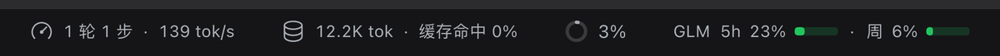
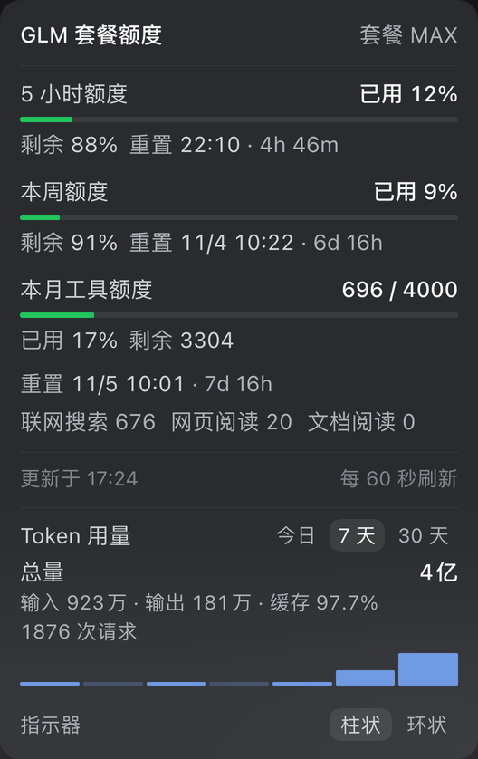
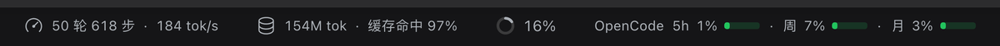
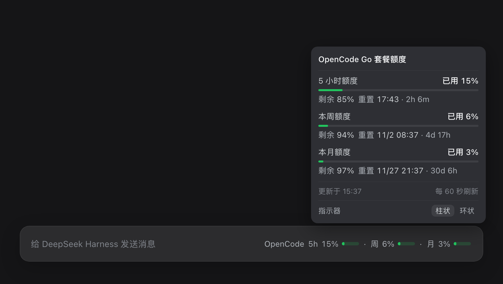
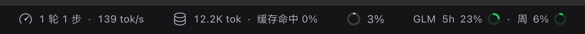
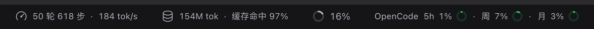

# dsh-quota

在 DeepSeek Harness 输入框下方的状态栏（`conversation.composer.dock`）显示**当前模型所属厂商的套餐额度**，并随模型切换自动切换。

```
GLM 5h 21% ▰ · 周 6% ▰                 ← 当前模型在智谱（zai-coding-cn）
OpenCode 5h 8% ▰ · 周 3% ▰ · 月 1% ▰         ← 当前模型在 OpenCode Go（opencode-go，三窗口用短标签）
Kimi 5h 24% ▰ · 周 42% ▰               ← 当前模型在 Kimi For Coding（kimi-coding）
小米 套餐 12% ▰ · 月 17% ▰             ← 当前模型在小米 Token 套餐（xiaomi-token-plan-*）
（其它厂商，例如官方 DeepSeek 账号，徽标不占位）
```

点击徽标弹出明细面板（样式对齐官方「上下文已用」面板，264px 宽紧凑布局）：

```
GLM 套餐额度                    套餐 最高
──────────────────────────────────────
5 小时额度                     已用 21%
▓▓▓▓░░░░░░░░░░░░░░░░░░
剩余 79%         重置 17:12 · 3h 12m

本周额度                         已用 6%
▓░░░░░░░░░░░░░░░░░░░░░
剩余 94%       重置 11/4 11:12 · 6d 21h

本月工具额度                  696 / 4000
▓▓▓░░░░░░░░░░░░░░░░░░░
已用 17% · 剩余 3304 · 重置 11/5 11:12 · 7d 21h
  联网搜索 676  网页阅读 20  文档阅读 0
──────────────────────────────────────
更新于 14:12                    每 60 秒刷新
Token 用量              今日  7天  30天
总量                          3.4亿
输入 586万 · 输出 78万 · 缓存 97.8%
1711 次请求
▁▁▁▂▃▅█
──────────────────────────────────────
指示器                        柱状  环状
```

## Token 用量统计

面板底部新增「Token 用量」区块，可在**今日 / 7 天 / 30 天**之间切换，显示：

- **总量**：输入 + 输出 + 缓存读取的合计 token 数
- **输入 / 输出 / 缓存命中率**（缓存命中 = `cacheReadTokens / (totalTokens - outputTokens)`，与 DSH 自带的「缓存命中」口径一致）
- **请求次数**，以及按天的迷你柱状图（今日 1 根，7 天 7 根，30 天 30 根）

数据来自**本机会话日志**（`$DSH_HOME/sessions/**/session*.jsonl.zstd`，逐帧解压后按事件时间归到本地自然日），完全本地计算：不联网、不上传、不落盘新文件。单次扫描 30 个会话约 60~250ms，结果按区间缓存 60 秒。

## 效果图

截图取自**真实的 DSH 界面**（本机 GUI，深色主题，无头 Chrome 连接后会截图；额度数字是截取那一刻的真实值）。

### GLM（智谱）

状态栏徽标（柱状条）：



点击后的明细面板：



### OpenCode Go

状态栏徽标：



明细面板：



### 环状指示器

面板底部「指示器」可切换柱状 / 环状：

| GLM | OpenCode Go |
|---|---|
|  |  |

## 自动切换逻辑

宿主侧路由 `GET /quota/active` 读取 DSH 的「当前默认模型选择」（`agentDefaultModel` 服务，每次切换模型都会更新），把 provider 映射到额度来源：

| provider | 来源 | 数据接口 |
|---|---|---|
| `zai-coding-cn` / `zai` | 智谱 GLM | `GET https://open.bigmodel.cn/api/monitor/usage/quota/limit` |
| `opencode-go` / `opencode` | OpenCode Go | `GET https://opencode.ai/zen/go/v1/usage` |
| `kimi-coding` | Kimi For Coding | `GET https://api.kimi.com/coding/v1/usages` |
| `xiaomi-token-plan-cn` / `-ams` / `-sgp` / `xiaomi` | 小米 Token 套餐 | `GET https://platform.xiaomimimo.com/api/v1/tokenPlan/usage` |
| 其它（如官方 DeepSeek 账号） | 无 | 徽标自动隐藏 |

切换模型后约 1 秒内跟着切换：客户端每秒查一次 `/quota/active`（宿主只读内存，开销可忽略），窗口重新获得焦点时立即查一次，另外订阅 `settings/document-updated` 事件做即时触发；额度本身每 60 秒刷新一次。

## 数据与语义

- 两个接口返回的都是**已用百分比**。智谱的 `TIME_LIMIT` 同时给 `696/4000` 与 `percentage: 17`，可证 `percentage` = 已用；OpenCode 的 `rolling/weekly/monthly` 同理。面板里同时给「剩余」。
- 智谱窗口：`TOKENS_LIMIT(unit=3,number=5)` → 5 小时、`TOKENS_LIMIT(unit=6)` → 本周、`TIME_LIMIT` → 本月工具额度（含分项）。
- OpenCode 窗口：`rolling` → **5 小时**（官方文档：5-hour = 月额度的 20%）、`weekly` → 本周（50%）、`monthly` → 本月（100%）；三个都显示在徽标上，徽标里用短标签 `5h / 周 / 月`（面板里仍是完整标题）。
- Kimi 窗口：`usage` → 本周汇总，`limits[]` 里 `window.duration=300 MINUTE` 的是 5 小时窗口；token 数用「万 / 亿」紧凑显示。
- 小米窗口：`usage.items` 的 `plan_total_token`（套餐）、`compensation_total_token`（补偿，仅有额度时显示）、`monthUsage.items` 的 `month_total_token`（本月总量）；接口给的是 token 数，百分比由 used/limit 计算。
- 重置倒计时用短单位、小写：`3h 12m`、`6d 21h`，整点省略分钟、整天省略小时、不足 1 分钟 `<1m`。
- 徽标内文字统一 12px / 同色 / 400 字重（与官方统计徽标同规格），进度条放在数字后面：常态绿、≥70% 琥珀、≥90% 红，轨道同色 18% 浅染。
- 徽标里窗口名用短标签（`5h` / `周` / `月`，面板里仍是完整标题），来源配置见 `client.js` 的 `SOURCES[*].shortLabels`。

## 安装方式

```bash
git clone https://github.com/shy3130/dsh-quota.git ~/Project/dsh-quota
```

插件包是标准 DSH bundle。当前安装方式是写进**本机用户补丁层** `~/.dsh/cordis.patch.yml`（`name` 换成你自己的克隆路径）：

```yaml
- insert:
    - id: dsh-quota
      name: '/Users/<you>/Project/dsh-quota/index.js'
```

指向 `index.js`（而不是包目录）：Node 的 ESM 不支持目录导入；客户端模块系统会从该文件向上找到 `package.json`，读取 `dsh.client` 后再加载 `client.js`。

**宿主侧改动（`index.js`）需要重启一次 DSH 桌面应用**才会生效（新增路由不会热加载）；只改 `client.js` 时页面刷新即可。改 `~/.dsh/cordis.patch.yml` 由 HMR 热加载。

## 路由

| 路由 | 用途 |
|---|---|
| `GET /quota/active` | 当前模型 → `{ provider, model, source }` |
| `GET /quota/config` | 界面偏好（`{ indicator: 'bar' | 'ring' }`） |
| `GET /quota/tokens?range=today\|7d\|30d` | Token 用量统计（读本机会话日志聚合） |
| `GET /quota/zhipu` | 智谱额度（归一化后） |
| `GET /quota/opencode` | OpenCode Go 额度（归一化后） |
| `GET /quota/kimi` | Kimi For Coding 额度（归一化后） |
| `GET /quota/xiaomi` | 小米 Token 套餐额度（归一化后） |

三者都带 DSH 登录门；密钥只在宿主进程内使用，不会进入返回给浏览器的 JSON。

## 配置

行上的 `config` 可覆盖各来源的地址与凭据引用：

```yaml
- insert:
    - id: dsh-quota
      name: '/Users/shy/Project/dsh-quota/index.js'
      config:
        sources:
          zhipu:
            baseUrl: 'https://open.bigmodel.cn'
            credentialRef: 'ZAI_CODING_CN_API_KEY'
          opencode:
            baseUrl: 'https://opencode.ai'
            credentialRef: 'OPENCODE_GO_API_KEY'
          kimi:
            baseUrl: 'https://api.kimi.com'
            credentialRef: 'KIMI_API_KEY'
          xiaomi:
            baseUrl: 'https://platform.xiaomimimo.com'
            credentialRef: 'XIAOMI_MIMO_SESSION_COOKIE'
```

### 指示器形态（柱状条 / 环状条）

打开面板，底部有一行「指示器：柱状 / 环状」的切换：

- 点击即切换，选择记在浏览器 `localStorage`（键 `dsh-quota:indicator`），刷新后保持
- 想改**默认值**（没点过切换的新环境）：给插件行加 `config`：

```yaml
- insert:
    - id: dsh-quota
      name: '@local/dsh-quota'
      config:
        indicator: ring   # bar（默认）| ring
```

> `/quota/config` 是宿主侧路由，改默认值需要**重启**；面板里的切换只需要刷新页面。

### 各家凭据从哪来

| 厂商 | 需要的凭据 | 获取方式 |
|---|---|---|
| 智谱 GLM | `ZAI_CODING_CN_API_KEY` | 智谱开放平台 API Key（与模型路由同一个） |
| OpenCode Go | `OPENCODE_GO_API_KEY` | OpenCode Zen 后台的 API Key |
| Kimi For Coding | `KIMI_API_KEY`，或 DSH 里 Kimi 的 OAuth 登录 | 优先读 DSH 凭据记录 `llm-pi-ai/kimi-coding` 的 access token；没有时用 `sk-kimi-...` API Key |
| 小米 Token 套餐 | `XIAOMI_MIMO_SESSION_COOKIE` | 小米用量接口只认浏览器 SSO **Cookie**（`tp-...` API Key 查不了）：登录 platform.xiaomimimo.com → DevTools → Cookies → 整条复制 |

凭据可以放在环境变量里，也可以经 DSH 的凭据服务按上面的名字保存（插件只用引用名，不落盘）。

## 卸载

删掉 `~/.dsh/cordis.patch.yml` 里对应的 `insert` 行，然后重启 DSH。

## 开发与维护

本目录既是插件包，也是 git 仓库（远程：`https://github.com/shy3130/dsh-quota`）。

```bash
npm test                 # 冒烟测试：清单/资源/语法/导出面，不联网
git add -A && git commit -m "..."
git push
```

改动生效方式：

| 改动位置 | 生效方式 |
|---|---|
| `client.js`（徽标、面板） | 刷新页面（Cmd+R）；客户端模块会热更新 |
| `index.js`（路由、取数） | **重启 DSH 桌面应用** |
| `~/.dsh/cordis.patch.yml`（挂载行） | HMR 热加载 |

⚠️ 安装行指向的是本目录的绝对路径（`/Users/shy/Project/dsh-quota/index.js`）。如果移动或重命名这个目录，要同步改补丁层的路径；如果以后按 bundle 方式安装（见上文），则改为包名引用，不再依赖绝对路径。

## 目录结构

| 文件 | 作用 |
|---|---|
| `index.js` | 宿主侧：三条路由、凭据读取、上游取数与归一化、缓存与登录门 |
| `client.js` | 浏览器侧：徽标、自动切换、点击面板与轮询 |
| `cordis.patch.yml` | bundle 自身的插件行（作为 profile bundle 安装时使用） |
| `package.json` | 清单：`exports`、`dsh.bundle.patch`、`dsh.client` |
| `locale/*.json` | 插件管理页显示的标题与说明 |
| `icon.svg` | 插件图标 |
