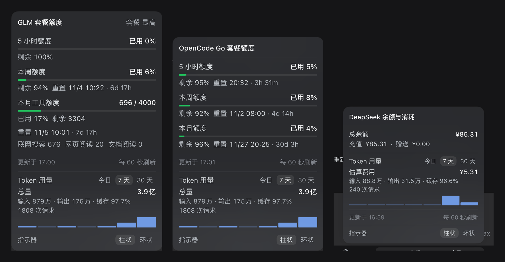
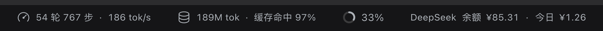
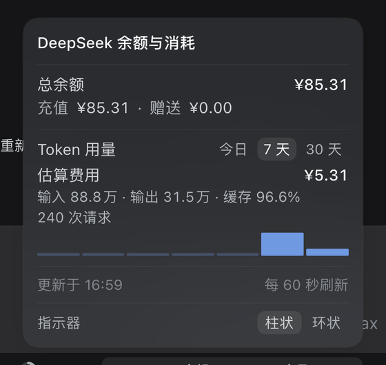

<div align="center">


# dsh-quota

**DeepSeek Harness 输入框状态栏 · 多厂商额度与消耗监控插件**

智谱 GLM · OpenCode Go · Kimi For Coding · 小米 Token 套餐 · DeepSeek 官方

[](https://github.com/shy3130/dsh-quota/releases)
[](./LICENSE)
[](https://github.com/deepseek-ai/deepseek-harness)
[](#)
[](#)



跟随当前模型自动切换 · 点开即看额度、倒计时、Token 用量与费用 · 数据本地聚合，凭据不外发

```bash
dsh plugin --profile desktop add github:shy3130/dsh-quota
```

</div>

---

## 目录

[特性](#特性) · [效果图](#效果图) · [安装](#安装) · [配置](#配置) · [使用与工作原理](#使用与工作原理) · [Token 用量统计](#token-用量统计) · [DeepSeek 官方监控](#deepseek-官方监控) · [隐私与安全](#隐私与安全) · [开发](#开发) · [项目结构](#项目结构) · [许可证](#许可证)

## 特性

- **自动跟随当前模型** —— 宿主读取 DSH 的默认模型选择，切换后约 1 秒内切到对应厂商徽标；未覆盖的厂商徽标自动隐藏、不占位
- **五家额度来源**
  - 智谱 GLM：5 小时窗口 · 本周 · 本月工具额度（含分项）
  - OpenCode Go：5 小时滚动窗 · 本周 · 本月
  - Kimi For Coding：5 小时窗口 · 本周汇总
  - 小米 Token 套餐：套餐额度 · 补偿额度 · 本月总量
  - DeepSeek 官方：账户余额（充值 / 赠送）+ 今日消耗
- **明细面板** —— 剩余 / 已用 / 重置倒计时（`6d 21h` 紧凑格式）、工具额度分项、柱状 / 环状指示器可切换并记忆
- **Token 用量统计** —— 今日 / 7 天 / 30 天切换：总量、输入 / 输出、缓存命中率、请求数与每日柱状图，全部本地计算
- **DeepSeek 费用估算** —— 按官方价目表（区分高峰 / 空闲时段）由本地 token 记录估算金额，不需要官方用量接口
- **纯插件、零侵入** —— 不修改任何官方源码；标准 DSH bundle，一条命令安装；所有路由带 DSH 登录门

## 效果图

> 下列截图均为**真实 DSH 界面**（深色主题，无头浏览器实拍），额度与余额为截取时刻的真实数据。

### 状态栏徽标

徽标贴在输入框右下角，跟随当前模型自动切换，点一下弹出明细：

<br>
<br>


### 明细面板

| GLM（智谱） | OpenCode Go | DeepSeek 官方 |
|:---:|:---:|:---:|
|  |  |  |
| 套餐窗口 + 工具额度 + Token 用量 | 5h / 周 / 月三窗 + Token 用量 | 余额（充值 / 赠送）+ 估算费用 |

### 环状指示器

面板底部可在柱状 / 环状两种指示器之间切换：

| GLM | OpenCode Go |
|:---:|:---:|
|  |  |

## 安装

### 环境要求

| 依赖 | 要求 |
|---|---|
| [DeepSeek Harness](https://github.com/deepseek-ai/deepseek-harness) | ≥ 0.2（预览版） |
| Node.js | 无需单独安装（使用 DSH 宿主自带运行时） |
| 凭据 | 对应厂商的 API Key / Cookie，见[配置](#配置) |

### 从 GitHub 安装（推荐）

```bash
# 安装（跟踪 main 最新提交）
dsh plugin --profile desktop add github:shy3130/dsh-quota

# 钉住某个发布版本（生产环境推荐）
dsh plugin --profile desktop add github:shy3130/dsh-quota#v1.2.1

# 更新已安装的版本
dsh plugin --profile desktop update @local/dsh-quota
```

- 安装 / 更新后需要**完全退出并重开 DSH**：宿主插件在启动时加载，仅刷新页面不够
- 各版本说明与源码包见 [Releases](https://github.com/shy3130/dsh-quota/releases)
- `pnpm-lock.yaml` 会把 GitHub 依赖钉到具体提交（`codeload.github.com/.../tar.gz/<sha>`），「更新」就是重新解析目标 ref 的最新提交

### 从源码安装（开发）

```bash
git clone https://github.com/shy3130/dsh-quota.git ~/Project/dsh-quota
dsh plugin --profile desktop add link:/Users/<you>/Project/dsh-quota
```

或写进用户补丁层 `~/.dsh/cordis.patch.yml`：

```yaml
- insert:
    - id: dsh-quota
      name: '/Users/<you>/Project/dsh-quota/index.js'
```

> `name` 要指向 `index.js` 而不是包目录：Node 的 ESM 不支持目录导入；客户端模块系统会从该文件向上找到 `package.json`，读取 `dsh.client` 后再加载 `client.js`。

### 卸载

```bash
dsh plugin --profile desktop remove @local/dsh-quota
```

源码补丁方式安装的，删除补丁层里对应的 `insert` 行。之后重启 DSH。

## 配置

### 凭据

| 厂商 | 需要的凭据 | 获取方式 |
|---|---|---|
| 智谱 GLM | `ZAI_CODING_CN_API_KEY` | 智谱开放平台 API Key（与模型路由同一个） |
| OpenCode Go | `OPENCODE_GO_API_KEY` | OpenCode Zen 后台的 API Key |
| Kimi For Coding | `KIMI_API_KEY`，或 DSH 里 Kimi 的 OAuth 登录 | 优先读 DSH 凭据记录 `llm-pi-ai/kimi-coding` 的 access token；没有时用 `sk-kimi-...` API Key |
| 小米 Token 套餐 | `XIAOMI_MIMO_SESSION_COOKIE` | 用量接口只认浏览器 SSO **Cookie**（`tp-...` API Key 查不了）：登录 platform.xiaomimimo.com → DevTools → Cookies → 整条复制 |
| DeepSeek 官方 | 通常不用（DSH 已登录 DeepSeek 账号即可）；否则 `DEEPSEEK_API_KEY` | 账号模式走 DSH 的 `deepseekAccount` 服务；API Key 模式走官方 `GET /user/balance` |

凭据可以放在环境变量里，也可以经 DSH 的凭据服务按上面的名字保存（插件只持引用名，不落盘）。

### 来源地址与凭据引用（可选）

插件行上的 `config` 可覆盖各来源的 baseUrl 与凭据引用：

```yaml
- insert:
    - id: dsh-quota
      name: '@local/dsh-quota'
      config:
        sources:
          zhipu:
            baseUrl: 'https://open.bigmodel.cn'
            credentialRef: 'ZAI_CODING_CN_API_KEY'
          opencode:
            baseUrl: 'https://opencode.ai'
            credentialRef: 'OPENCODE_GO_API_KEY'
          kimi:
            baseUrl: 'https://api.kimi.com'
            credentialRef: 'KIMI_API_KEY'
          xiaomi:
            baseUrl: 'https://platform.xiaomimimo.com'
            credentialRef: 'XIAOMI_MIMO_SESSION_COOKIE'
```

### 指示器默认形态

面板底部可随时切换柱状 / 环状指示器，选择记在浏览器 `localStorage`（键 `dsh-quota:indicator`），刷新后保持。想改**默认值**（没点过切换的新环境）：

```yaml
- insert:
    - id: dsh-quota
      name: '@local/dsh-quota'
      config:
        indicator: ring   # bar（默认）| ring
```

> 默认值经宿主路由 `/quota/config` 读取，修改后需**重启 DSH**；面板内的切换只需刷新页面。

## 使用与工作原理

### 自动切换

宿主路由 `GET /quota/active` 读取 DSH 的「当前默认模型选择」（`agentDefaultModel` 服务，每次切换模型都会更新），把 provider 映射到额度来源：

| provider | 来源 | 数据接口 |
|---|---|---|
| `zai-coding-cn` / `zai` | 智谱 GLM | `GET https://open.bigmodel.cn/api/monitor/usage/quota/limit` |
| `opencode-go` / `opencode` | OpenCode Go | `GET https://opencode.ai/zen/go/v1/usage` |
| `kimi-coding` | Kimi For Coding | `GET https://api.kimi.com/coding/v1/usages` |
| `xiaomi-token-plan-cn` / `-ams` / `-sgp` / `xiaomi` | 小米 Token 套餐 | `GET https://platform.xiaomimimo.com/api/v1/tokenPlan/usage` |
| `deepseek-account` / `deepseek-api-key` / `deepseek` | DeepSeek 官方 | DSH 账号服务（平台钱包）或 `GET https://api.deepseek.com/user/balance` |
| 其它 | 无 | 徽标自动隐藏 |

客户端每秒查询一次 `/quota/active`（宿主只读内存，开销可忽略），窗口重新获得焦点时立即查询，另订阅 `settings/document-updated` 事件即时触发；额度数据本身每 60 秒刷新一次。

### 徽标示意

```text
GLM 5h 21% ▰ · 周 6% ▰                     ← 智谱（zai-coding-cn）
OpenCode 5h 8% ▰ · 周 3% ▰ · 月 1% ▰       ← OpenCode Go（opencode-go）
Kimi 5h 24% ▰ · 周 42% ▰                   ← Kimi For Coding（kimi-coding）
小米 套餐 12% ▰ · 月 17% ▰                 ← 小米 Token 套餐（xiaomi-token-plan-*）
DeepSeek 余额 ¥85.31 · 今日 ¥1.26          ← DeepSeek 官方（deepseek-account）
```

### 数据口径

<details>
<summary>各家接口字段与界面细节（点开展开）</summary>

- 两个接口返回的都是**已用百分比**。智谱的 `TIME_LIMIT` 同时给 `696/4000` 与 `percentage: 17`，可证 `percentage` = 已用；OpenCode 的 `rolling/weekly/monthly` 同理。面板里同时给「剩余」。
- 智谱窗口：`TOKENS_LIMIT(unit=3,number=5)` → 5 小时、`TOKENS_LIMIT(unit=6)` → 本周、`TIME_LIMIT` → 本月工具额度（含分项）。
- OpenCode 窗口：`rolling` → **5 小时**（官方文档：5-hour = 月额度的 20%）、`weekly` → 本周（50%）、`monthly` → 本月（100%）；三个窗口都显示在徽标上。
- Kimi 窗口：`usage` → 本周汇总，`limits[]` 里 `window.duration=300 MINUTE` 的是 5 小时窗口；token 数用「万 / 亿」紧凑显示。
- 小米窗口：`usage.items` 的 `plan_total_token`（套餐）、`compensation_total_token`（补偿，仅有额度时显示）、`monthUsage.items` 的 `month_total_token`（本月总量）；接口给的是 token 数，百分比由 used/limit 计算。
- 重置倒计时用短单位、小写：`3h 12m`、`6d 21h`，整点省略分钟、整天省略小时、不足 1 分钟 `<1m`。
- 徽标内文字统一 12px / 同色 / 400 字重（与官方统计徽标同规格），进度条放在数字后面：常态绿、≥70% 琥珀、≥90% 红，轨道同色 18% 浅染。
- 徽标里窗口名用短标签（`5h` / `周` / `月`，面板里仍是完整标题），来源配置见 `client.js` 的 `SOURCES[*].shortLabels`。

</details>

### HTTP 路由

<details>
<summary>插件注册的路由一览（点开展开）</summary>

| 路由 | 用途 |
|---|---|
| `GET /quota/active` | 当前模型 → `{ provider, model, source }` |
| `GET /quota/config` | 界面偏好（`{ indicator: 'bar' \| 'ring' }`） |
| `GET /quota/tokens?range=today\|7d\|30d[&provider=deepseek]` | Token 用量统计（读本机会话日志聚合，可过滤厂商） |
| `GET /quota/deepseek` | DeepSeek 官方余额（总余额 / 充值 / 赠送） |
| `GET /quota/zhipu` | 智谱额度（归一化后） |
| `GET /quota/opencode` | OpenCode Go 额度（归一化后） |
| `GET /quota/kimi` | Kimi For Coding 额度（归一化后） |
| `GET /quota/xiaomi` | 小米 Token 套餐额度（归一化后） |

所有路由都带 DSH 登录门；密钥只在宿主进程内使用，不会进入返回给浏览器的 JSON。

</details>

## Token 用量统计

面板底部「Token 用量」区块，可在**今日 / 7 天 / 30 天**之间切换，显示：

- **总量**：输入 + 输出 + 缓存读取的合计 token 数
- **输入 / 输出 / 缓存命中率**（缓存命中 = `cacheReadTokens / (totalTokens - outputTokens)`，与 DSH 自带口径一致）
- **请求次数**，以及按天的迷你柱状图（今日 1 根，7 天 7 根，30 天 30 根）

数据来自**本机会话日志**（`$DSH_HOME/sessions/**/session*.jsonl.zstd`），完全本地计算：不联网、不上传、不落盘新文件。

<details>
<summary>实现细节（点开展开）</summary>

- 会话日志是**多帧 zstd** 拼接的 JSONL：按魔数 `28 b5 2f fd` 切帧逐段解压后，必须先合并字节流再按行切分（跨帧的 JSON 行才不会丢）
- 每条 `assistant/message` 的 `usage` 按 `request/context`（回退 `request/header` / `model/selection`）归因到 provider + model
- 单次扫描 30 个会话约 60~250 ms；结果按 `range:provider` 缓存 60 秒，并发请求合并

</details>

## DeepSeek 官方监控

DeepSeek 官方只开放了一个余额接口（`GET https://api.deepseek.com/user/balance`），没有用量接口，所以余额和消耗分开取：

- **余额**：优先用 DSH 已登录的 DeepSeek 账号（`deepseekAccount` 服务的平台钱包 `get_user_summary`，不需要额外凭据）；没登录时退回官方 API（需要 `DEEPSEEK_API_KEY`）
- **今日消耗**：由本机会话日志算出 DeepSeek 官方模型的 token，再按官方价格表换算成金额

徽标显示 `DeepSeek 余额 ¥85.31 · 今日 ¥1.26`；面板分「余额」与「Token 用量」两区（见右上图），Token 区在 DeepSeek 面板下自动切换为**估算费用**口径（含每日费用柱状图）。

### 价格与口径

<details>
<summary>价目表与估算规则（点开展开）</summary>

按官方价目表（元 / 百万 tokens）：

| 模型 | 输入（缓存命中） | 输入（未命中） | 输出 |
|---|---|---|---|
| `deepseek-flash` | 0.02 / 0.04 | 1 / 2 | 4 / 8 |
| `deepseek-v4-pro` | 0.15 / 0.30 | 4.5 / 9 | 13.5 / 27 |

- 每档是「空闲 / 高峰」两列：北京时间**工作日 9:00–12:00、14:00–18:00** 为高峰，其余（含周末）为空闲
- 价格表内置在 `index.js` 的 `DEEPSEEK_PRICING` 里，官方调价时改这里即可
- 金额是**估算**：按每条请求的 token × 该请求发生时刻的时段单价累加；法定节假日按工作日计算，金额会略微偏高
- 缓存命中率沿用 DSH 口径：`cacheReadTokens / (totalTokens - outputTokens)`

</details>

## 隐私与安全

- **凭据不出宿主**：API Key / Cookie 只在宿主进程内使用，返回给浏览器的 JSON 不包含任何密钥
- **登录门**：所有插件路由经 DSH 的 `connection.requestRejection` 鉴权，未登录请求会被拒绝
- **Token 统计完全本地**：读本机会话日志、内存聚合、不写入新文件、不上传
- **零遥测**：不收集、不上报任何数据；对厂商接口只发起额度查询

## 开发

```bash
git clone https://github.com/shy3130/dsh-quota.git && cd dsh-quota
npm test                                    # node --test：冒烟 + token 聚合，不联网
dsh plugin --profile desktop add link:$(pwd)
```

### 改动生效方式

| 改动位置 | 生效方式 |
|---|---|
| `client.js`（徽标、面板） | 刷新页面（Cmd+R），客户端模块热更新 |
| `index.js`（路由、取数） | **重启 DSH 桌面应用** |
| profile 补丁 / `~/.dsh/cordis.patch.yml` 挂载行 | HMR 热加载 |

### 发布流程

```bash
npm test
git add -A && git commit -m "..." && git push
git tag v1.2.x && git push origin v1.2.x
git archive --format=tar.gz --prefix=dsh-quota-1.2.x/ -o dsh-quota-1.2.x.tar.gz v1.2.x
gh release create v1.2.x dsh-quota-1.2.x.tar.gz --notes "..."
```

## 项目结构

| 文件 | 作用 |
|---|---|
| `index.js` | 宿主侧：路由注册、凭据读取、上游取数与归一化、缓存与登录门、token 聚合与费用估算 |
| `client.js` | 浏览器侧：徽标、自动切换、明细面板、指示器与用量图表 |
| `cordis.patch.yml` | bundle 自身的插件行（作为 profile bundle 安装时使用） |
| `package.json` | 清单：`exports`、`dsh.bundle.patch`、`dsh.client` |
| `locale/*.json` | 插件管理页显示的标题与说明（中 / 英） |
| `icon.svg` | 插件图标 |
| `test/*.mjs` | 冒烟与 token 聚合测试 |
| `docs/images/` | README 截图（真实界面实拍） |

## 许可证

[MIT](./LICENSE) © shy3130

本插件基于 [DeepSeek Harness](https://github.com/deepseek-ai/deepseek-harness) 插件 API 构建。

[](https://github.com/deepseek-ai/deepseek-harness)
